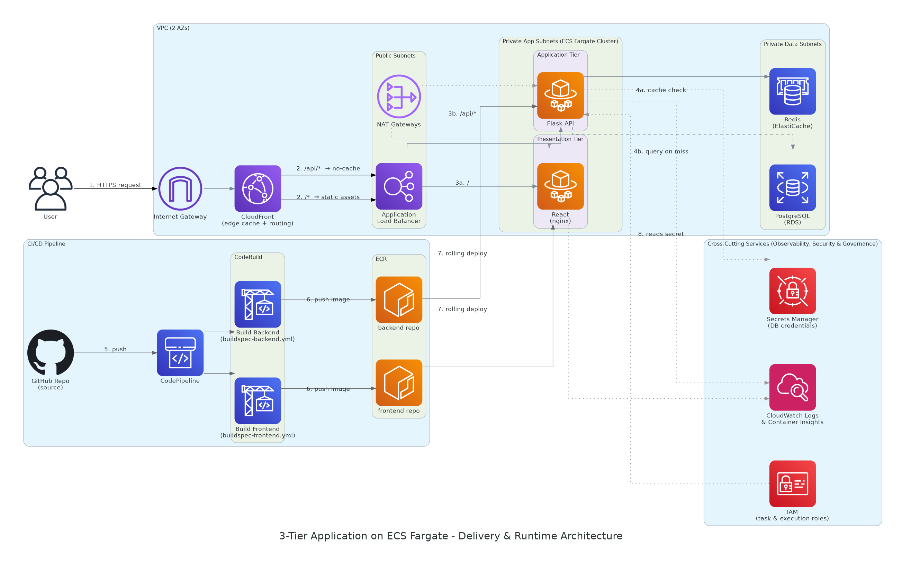
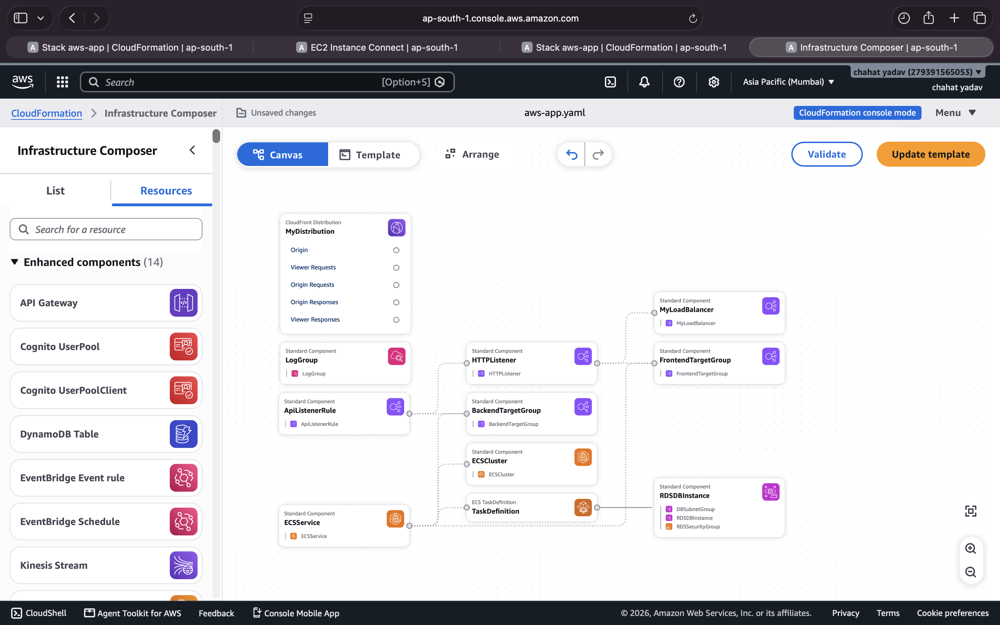
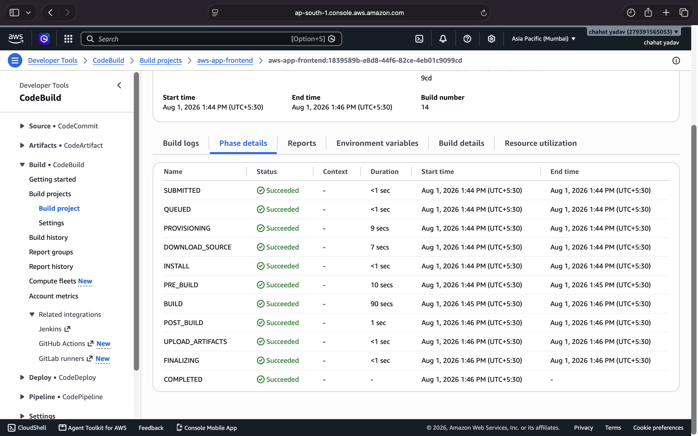
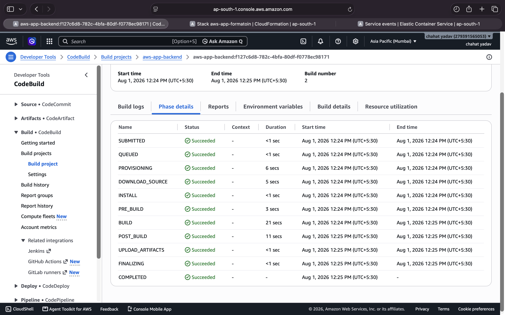
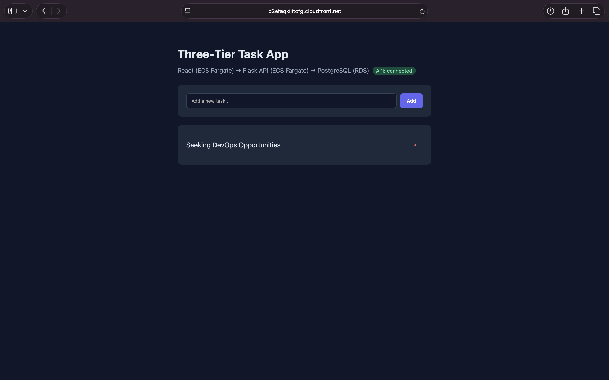
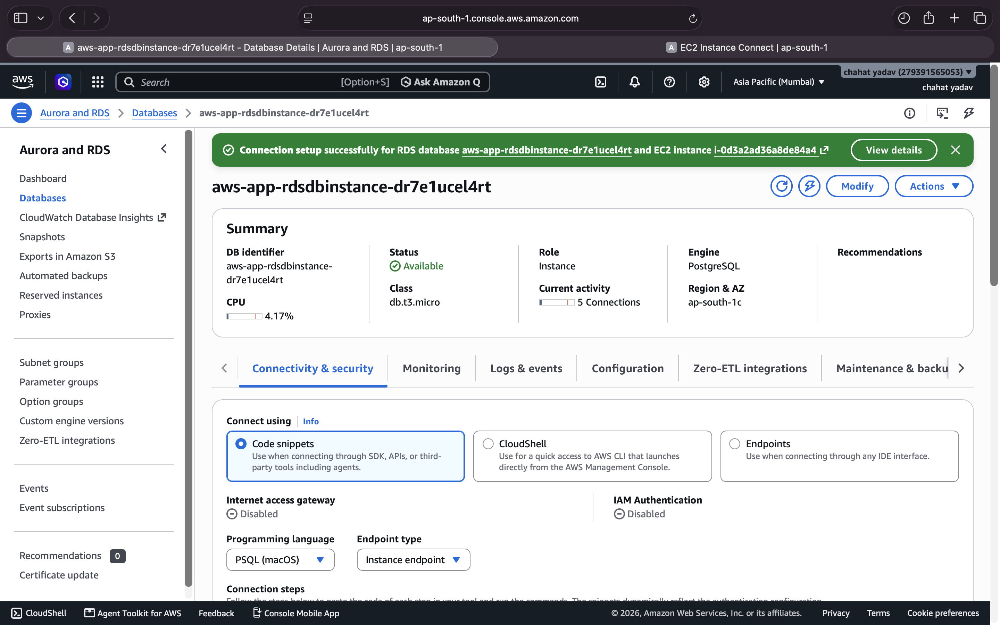
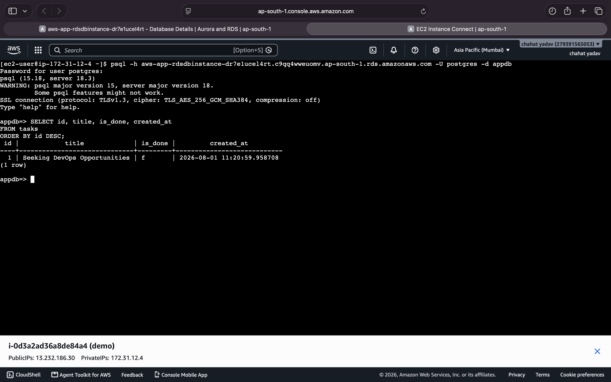
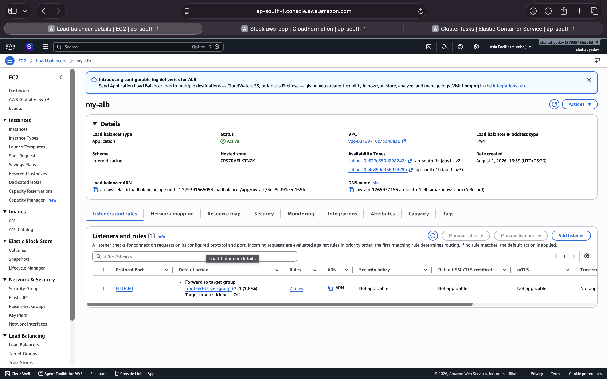
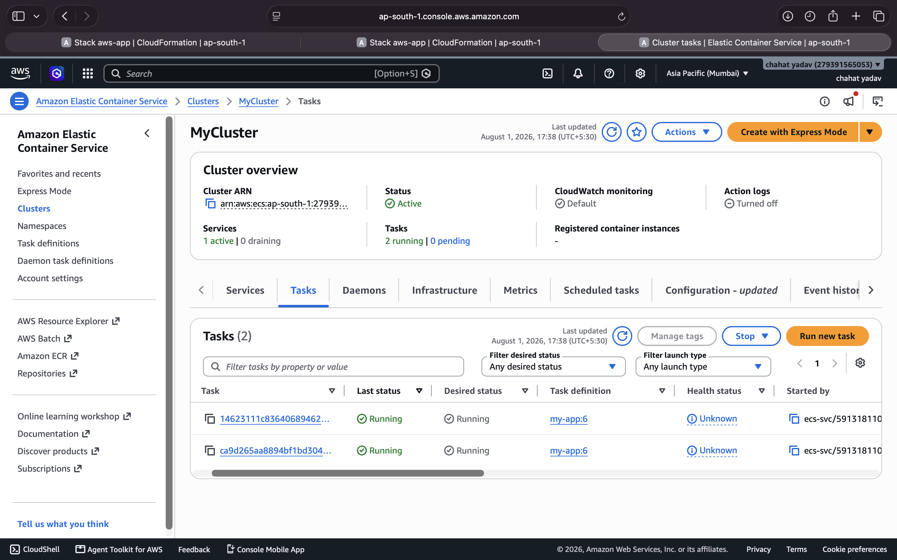

# Three-Tier Application on AWS ECS Fargate

A production-style three-tier application deployed on **Amazon ECS Fargate** using **AWS CloudFormation** for infrastructure provisioning.

The application consists of:

- **Frontend:** React + Nginx
- **Backend:** Python Flask REST API
- **Database:** Amazon RDS PostgreSQL

Container images are built using **AWS CodeBuild**, pushed to **Amazon ECR**, and the complete infrastructure is deployed through a single **CloudFormation** template.

---

# Architecture

This architecture demonstrates a scalable and serverless deployment using ECS Fargate.



---

# AWS Services Used

- Amazon ECS (Fargate)
- Application Load Balancer
- Amazon RDS (PostgreSQL)
- Amazon ECR
- AWS CodeBuild
- AWS CloudFormation
- Amazon VPC
- IAM
- CloudWatch Logs

---

# Infrastructure Provisioning

The complete infrastructure including networking, ECS services, load balancer, IAM roles and database is created using **AWS CloudFormation**.



---

# Build Pipeline

## Frontend Image Build

Frontend Docker image is built using **AWS CodeBuild** and pushed to Amazon ECR.



---

## Backend Image Build

Backend Docker image is built using **AWS CodeBuild** and pushed to Amazon ECR.



---

# Application

The frontend communicates with the Flask backend through the Application Load Balancer.



---

# Database

Amazon RDS PostgreSQL stores application data.



---

# Database Verification

Verifying records directly from PostgreSQL.



---

#  Application Load Balancer

The Application Load Balancer distributes incoming traffic to the ECS services.



---

# Amazon ECS

Frontend and backend containers are deployed as separate ECS Fargate services.



---

# Project Highlights

- Infrastructure provisioned using **AWS CloudFormation**
- Containerized frontend and backend
- ECS Fargate serverless deployment
- Docker images stored in Amazon ECR
- Automated image builds using AWS CodeBuild
- Application Load Balancer for traffic routing
- PostgreSQL database hosted on Amazon RDS
- Production-style three-tier architecture

---

## Repository Structure

```
.
├── app/
│   ├── frontend/
│   └── backend/
├── images/
├── buildspec-frontend.yml
├── buildspec-backend.yml
├── template.yaml
└── README.md
```

---

## Tech Stack

- AWS ECS Fargate
- AWS CloudFormation
- AWS CodeBuild
- Amazon ECR
- Amazon RDS PostgreSQL
- Application Load Balancer
- Docker
- React
- Flask
- Python
- PostgreSQL