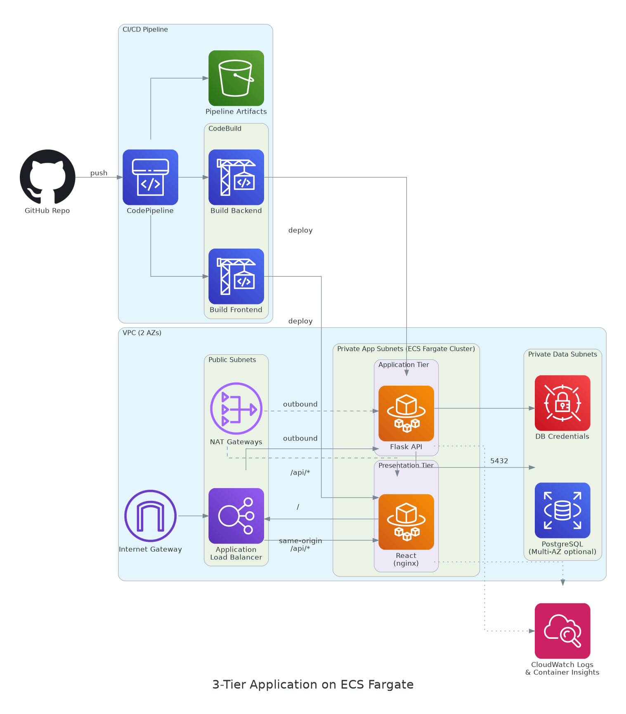

# Three-Tier Application on ECS Fargate

A production-shaped 3-tier reference architecture:

- **Presentation tier** — React SPA, served by nginx, running on ECS Fargate
- **Application tier** — Python Flask API, running on ECS Fargate
- **Data tier** — PostgreSQL on Amazon RDS

CI/CD is a full CodePipeline: **GitHub → CodeBuild (build & push images) → ECS rolling deploy**, provisioned entirely with CloudFormation.



## How traffic flows

One Application Load Balancer does path-based routing so the browser only ever talks to one origin:

- `/*` → **frontend** target group (React static files via nginx)
- `/api/*` → **backend** target group (Flask API)

Both ECS services run in **private** app subnets with no public IP; only the ALB is internet-facing. The backend is the only tier allowed to reach RDS, which sits in its own private data subnets and is never publicly accessible.

## Repository layout

```
app/
  backend/         Flask API (tasks CRUD + /api/health), Dockerfile
  frontend/         React SPA, Dockerfile (multi-stage: node build -> nginx)
infrastructure/
  01-network.yaml           VPC, subnets (public/app/data), NAT, security groups
  02-database.yaml          RDS PostgreSQL + Secrets Manager credentials
  03-ecr-alb-cluster.yaml   ECR repos, ALB, listener rules, ECS cluster
  04-ecs-services.yaml      Task definitions + Fargate services
  05-pipeline.yaml          CodePipeline + 2 CodeBuild projects + IAM roles
buildspec-backend.yml       CodeBuild instructions for the backend image
buildspec-frontend.yml      CodeBuild instructions for the frontend image
deploy.sh                   Deploys all 5 stacks in the right order
push-initial-images.sh      Pushes a first 'latest' image to each ECR repo
```

## Prerequisites

- AWS CLI v2, configured with credentials that can create VPC/RDS/ECS/IAM/CodePipeline resources
- Docker installed locally (for the one-time initial image push)
- A GitHub repository containing this code, pushed to a branch (e.g. `main`)
- An AWS CodeStar Connection to GitHub — CloudFormation can't complete the GitHub OAuth handshake, so create it once manually:

  ```bash
  aws codestar-connections create-connection \
    --provider-type GitHub \
    --connection-name threetier-app-github
  ```

  Then open **Developer Tools → Settings → Connections** in the AWS Console and click **Update pending connection** to authorize it. Copy the resulting Connection ARN — you'll need it below.

## Deployment order (why it matters)

CloudFormation can't create an ECS service pointing at an ECR image tag that doesn't exist yet, and the pipeline needs the ECS services to already exist as its deploy target. So the order is:

1. **Network** (VPC, subnets, security groups)
2. **Database** (RDS + Secrets Manager)
3. **Edge** (ECR repos, ALB, ECS cluster)
4. **Push one initial image** to each ECR repo, tagged `latest` (manual, one-time)
5. **ECS services** (now `latest` resolves to a real image)
6. **Pipeline** (from here on, every push to `main` rebuilds and redeploys both services automatically)

### Option A — guided script

```bash
chmod +x deploy.sh push-initial-images.sh
./deploy.sh threetier-app us-east-1
./push-initial-images.sh threetier-app us-east-1
./deploy.sh threetier-app us-east-1 services
```

The script will prompt for your GitHub owner/repo and CodeStar Connection ARN when it reaches the pipeline stack.

### Option B — manual, stack by stack

```bash
ENV=threetier-app
REGION=us-east-1

aws cloudformation deploy --stack-name $ENV-network \
  --template-file infrastructure/01-network.yaml \
  --parameter-overrides EnvironmentName=$ENV --region $REGION

aws cloudformation deploy --stack-name $ENV-database \
  --template-file infrastructure/02-database.yaml \
  --parameter-overrides EnvironmentName=$ENV \
  --capabilities CAPABILITY_IAM --region $REGION

aws cloudformation deploy --stack-name $ENV-edge \
  --template-file infrastructure/03-ecr-alb-cluster.yaml \
  --parameter-overrides EnvironmentName=$ENV --region $REGION

./push-initial-images.sh $ENV $REGION

aws cloudformation deploy --stack-name $ENV-services \
  --template-file infrastructure/04-ecs-services.yaml \
  --parameter-overrides EnvironmentName=$ENV \
  --capabilities CAPABILITY_NAMED_IAM --region $REGION

aws cloudformation deploy --stack-name $ENV-pipeline \
  --template-file infrastructure/05-pipeline.yaml \
  --parameter-overrides EnvironmentName=$ENV \
      GitHubOwner=<your-github-username> \
      GitHubRepo=<your-repo-name> \
      CodeStarConnectionArn=<connection-arn> \
  --capabilities CAPABILITY_NAMED_IAM --region $REGION
```

## Getting the app URL

```bash
aws cloudformation describe-stacks --stack-name threetier-app-edge \
  --query "Stacks[0].Outputs[?OutputKey=='ALBDNSName'].OutputValue" \
  --output text --region us-east-1
```

Open that DNS name in a browser — you'll see the task list UI. Adding a task calls `POST /api/tasks`, which the ALB routes to the Flask service, which writes to RDS.

## How the pipeline updates running services

Each CodeBuild project builds its Docker image, pushes `latest` and a commit-hash tag to ECR, and writes an `imagedefinitions.json` naming the container and the new image URI. CodePipeline's built-in **ECS deploy action** reads that file and calls `UpdateService`, which performs a standard ECS rolling deployment — new tasks start and pass the ALB health check before old tasks are drained, so there's no downtime.

## Cost-conscious defaults

- `db.t3.micro`, single-AZ RDS by default (flip `MultiAZ` to `true` for production)
- 2 NAT Gateways (one per AZ) for HA — drop to 1 if you want to cut cost and accept a single point of failure for outbound traffic
- Fargate tasks sized at 256 CPU / 512 MB per tier — bump `*Cpu`/`*Memory` parameters in `04-ecs-services.yaml` if the app needs more

## Tearing it down

Delete stacks in reverse order (pipeline → services → edge → database → network). Empty the S3 artifact bucket first, since CloudFormation won't delete a non-empty bucket:

```bash
aws s3 rm s3://$(aws cloudformation describe-stacks --stack-name $ENV-pipeline \
  --query "Stacks[0].Outputs[?OutputKey=='ArtifactBucketName'].OutputValue" --output text) --recursive

for STACK in pipeline services edge database network; do
  aws cloudformation delete-stack --stack-name $ENV-$STACK --region $REGION
  aws cloudformation wait stack-delete-complete --stack-name $ENV-$STACK --region $REGION
done
```

Note: `02-database.yaml` uses `DeletionPolicy: Snapshot`, so deleting that stack leaves a final RDS snapshot behind — delete it manually from the RDS console if you don't need it.
# aws-app
